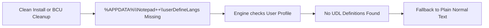

# Diagnostic & Resolution Guide: Missing Markdown (.md) Syntax Highlighting
# دليل استكشاف وحل مشكلة اختفاء التمييز اللوني لملفات Markdown

---

## 1. Executive Summary & Symptoms | ملخص التوصيف والأعراض

When opening Markdown (`.md` or `.markdown`) files in Notepad++, the document may render as plain unhighlighted text (`Normal Text / TXT`), lacking headers, lists, code block styling, and link coloring. In the **Language** menu, the pre-installed Markdown entries (`Markdown (preinstalled)` or `Markdown (preinstalled dark mode)`) may be absent or inactive.

عند فتح ملفات Markdown (امتداد `.md` أو `.markdown`) في برنامج Notepad++، قد تظهر النصوص كملف نصي عادي بلون افتراضي موحد (`Normal Text`) دون تمييز للعناوين أو القوائم أو الروابط. كما قد تختفي خيارات `Markdown (preinstalled)` من أسفل قائمة **Language** (اللغة).

---

## 2. Root Cause Analysis | التحليل الهندسي والسبب الجذري



### Architectural Separation
Notepad++ bifurcates configuration and application data into two distinct directory trees:
1. **Machine Program Root (`C:\Program Files\Notepad++`)**:
   Contains fixed binaries and read-only baseline model files (`langs.model.xml`, `stylers.model.xml`, and the installer's copy of `userDefineLangs/`).
2. **User Profile Directory (`%APPDATA%\Notepad++`)**:
   Contains active per-user configuration files (`langs.xml`, `stylers.xml`, and active custom languages in `userDefineLangs/`).

### Why It Occurs
1. **User Defined Language (UDL) Mechanism**: Unlike built-in Lexilla lexers (C++, Python, Java) defined in `langs.model.xml`, Markdown is implemented as an XML-based User Defined Language (UDL).
2. **Profile Cleansing**: Uninstallation tools such as **Bulk Crap Uninstaller (BCU)** or manual uninstalls frequently purge the entire `%APPDATA%\Notepad++\` directory to eliminate leftover files.
3. **Missing Engine Auto-Recovery (Prior to v2026.11.22.02)**: In legacy releases, while the engine automatically replicated `langs.model.xml` into `%APPDATA%\langs.xml` upon first launch, it lacked a corresponding self-healing routine for `userDefineLangs/`. Consequently, if the installer only placed files in `Program Files`, clean installations or purged profiles had no active Markdown definition in `AppData`.

---

## 3. Permanent Automated Resolution (v2026.11.22.02+) | الحل الجذري التلقائي

Starting with release **v2026.11.22.02**, Notepad++ introduces an automated self-healing bootstrap in `Parameters.cpp`.

### Engine Logic
Upon startup, the engine evaluates whether `_userPath` differs from `_nppPath`. If the user's `userDefineLangs/` folder is missing or lacks the pre-installed definitions, the engine automatically:
1. Verifies the existence of baseline definitions in `[Program Files]\Notepad++\userDefineLangs\`.
2. Creates `%APPDATA%\Notepad++\userDefineLangs\` if not already present.
3. Copies baseline XML definitions (`markdown._preinstalled.udl.xml` and `markdown._preinstalled_DM.udl.xml`) without overwriting any custom modifications created by the user.

**Outcome**: Users installing Notepad++ cleanly on a fresh Windows system or following complete AppData cleanses will have Markdown syntax highlighting operational out-of-the-box on the very first launch.

---

## 4. Manual Restoration for Prior Versions | الحل اليدوي للإصدارات السابقة

If you are running an earlier build and cannot immediately upgrade to `v2026.11.22.02`, apply one of the following remediation methods:

### Method A: One-Line PowerShell Command (Recommended)
Open **PowerShell** and execute:

```powershell
Copy-Item -Path "C:\Program Files\Notepad++\userDefineLangs" -Destination "$env:APPDATA\Notepad++\" -Recurse -Force
```

### Method B: Manual File Placement
1. Navigate to: `C:\Program Files\Notepad++\userDefineLangs\`
2. Copy the two files:
   - `markdown._preinstalled.udl.xml`
   - `markdown._preinstalled_DM.udl.xml`
3. Press `Win + R`, enter `%APPDATA%\Notepad++`, and create a new folder named `userDefineLangs`.
4. Paste the copied XML files into `%APPDATA%\Notepad++\userDefineLangs\`.
5. Restart Notepad++.

---

## 5. Verification & Quality Assurance | التحقق وضمان الجودة

To confirm that Markdown syntax highlighting is active:
1. Open any `.md` file or create a new file and save it as `test.md`.
2. Enter standard Markdown syntax:
   ```markdown
   # Sample Header
   - List item with **bold text**
   [Link Reference](https://github.com/ReCodera-AI/notepad-plus-plus)
   ```
3. Verify that the header, bold formatting, and link tags are highlighted with distinct colors.
4. Check the bottom status bar or the **Language** menu; `Markdown (preinstalled)` must appear checked.
